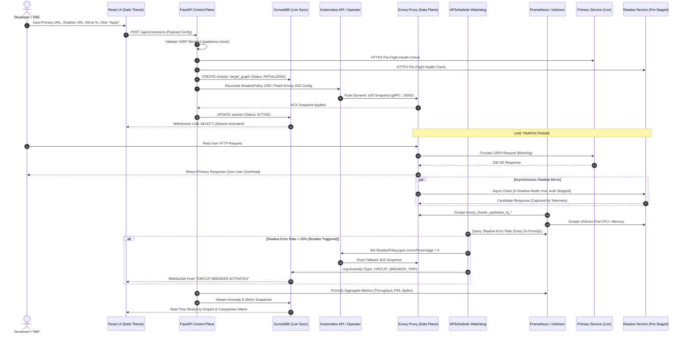

# Product Requirements Document (PRD)

# Project: ShadowCast
**Next-Generation Zero-Risk Traffic Shadowing, Telemetry, and Differential Validation Platform**

---

| Document Attribute | Details |
| :--- | :--- |
| **Product Name** | **ShadowCast** |
| **Document Version** | `1.0.0-PROD` |
| **Status** | Approved for Implementation |
| **Target Audience** | Backend Engineers, DevOps / SREs, Release Managers, Platform Architects |
| **Operational Model** | Pre-Staged URL Traffic Shadowing & Differential Telemetry (Decoupled from CI/CD) |
| **Kubernetes API** | `traffic.shadowcast.io/v1alpha1` (`ShadowPolicy`) |
| **Data Plane** | Envoy Proxy (v1.28+) via Dynamic xDS gRPC (Port 18000) + `diferencia` |
| **Control Plane** | Python 3.11+ / FastAPI + Go Controller-Runtime Operator |
| **Real-Time Layer** | SurrealDB (`LIVE SELECT` over WebSockets) + Prometheus (`cAdvisor`) |

---

## 1. Executive Summary & Problem Statement

### 1.1 The Core Problem
Modern cloud-native engineering organizations face an existential dilemma when deploying software updates to mission-critical distributed systems:

1. **The "Production Blast Radius" Paradox:** Traditional canary releases, blue-green deployments, and feature flags still route a percentage ($1\% - 10\%$) of real users to unproven candidate builds. When regressions occur, real users encounter HTTP 500 errors, broken checkout flows, and degraded latencies, directly causing revenue loss, customer support spikes, and brand damage.
2. **Synthetic Staging vs. Real-World Entropy:** Staging, QA, and pre-production environments consistently fail to capture genuine user behavior. Synthetic tests lack the data cardinality, unexpected query parameter combinations, complex authentication token variations, concurrency spikes, and payload mutations seen in live production traffic.
3. **CI/CD Pipeline Coupling & Deployment Friction:** Existing shadowing or testing tools often demand tight integration with CI/CD deployment pipelines, Kubernetes cluster-level ingress controllers, or invasive service mesh configurations (e.g., full-mesh Istio/Linkerd overrides). This introduces operational friction and blocks ad-hoc validation of isolated candidate builds.
4. **The "Strict JSON Equality" Fallacy:** Traditional diff-based validation tools enforce strict byte-for-byte or JSON body equality. However, candidate releases **intentionally** modify response structures (e.g., adding telemetry fields, deprecating legacy attributes, formatting datetimes, or updating database auto-increment IDs). Strict JSON parity results in massive alert fatigue, rendering automated validation useless.

```
┌────────────────────────────────────────────────────────────────────────┐
│                        THE TRADITIONAL RISK                             │
│                                                                        │
│   Live User Traffic ───► Ingress ───► [ Canary Pod (v2.0-rc1) ]         │
│                                            │ (Bug / 500 Error)         │
│                                            ▼                           │
│                                      REAL USER FAILS                    │
└────────────────────────────────────────────────────────────────────────┘
```

### 1.2 The Solution: ShadowCast
**ShadowCast** is a zero-risk traffic-shadowing and release-validation platform that decouples release testing from both CI/CD pipelines and end-user responses.

* **Pre-Staged URL Architecture:** Developers pre-deploy both their stable production service (**Primary URL**) and candidate service (**Shadow URL**). ShadowCast functions strictly as the external mirroring, telemetry, and validation coordinator.
* **Asynchronous Non-Blocking Duplication:** The live user request is routed to the Primary URL and returned immediately. A clone of the request is asynchronously forwarded to the Shadow URL with the header `X-Shadow-Mode: true` and sanitized authentication headers.
* **Validation Philosophy (HTTP Stability & Performance over JSON Parity):** ShadowCast treats candidate releases as successful if they maintain HTTP `2xx` / `200 OK` stability, low tail latency ($P95$, $P99$), consistent throughput capacity, and safe CPU/memory resource consumption—without requiring identical JSON payload structures.
* **Automated Guardrails & Real-Time Sync:** A 5-second background circuit breaker drops traffic mirroring to $0\%$ if the candidate begins failing, while SurrealDB `LIVE SELECT` streams granular per-request anomaly data directly to a sleek, dark-themed React UI.

```
┌────────────────────────────────────────────────────────────────────────┐
│                        SHADOWCAST ZERO-RISK ARCHITECTURE               │
│                                                                        │
│                          Live User Traffic                             │
│                                 │                                      │
│                                 ▼                                      │
│                        [ Envoy Data Plane ]                            │
│                         /                 \                            │
│            100% Request/                   \ Mirrored Request (1%-100%)│
│            Full Response                   \ [X-Shadow-Mode: true]    │
│                 ▼                           ▼                          │
│        [ Primary Service ]        [ Pre-Staged Shadow Service ]        │
│                 │                                   │                  │
│                 ▼                                   ▼                  │
│       Real User (Zero Impact)            Shadow Telemetry Engine       │
│                                            (HTTP 200 / Latency / OOM)  │
└────────────────────────────────────────────────────────────────────────┘
```

---

## 2. Current Scope vs. Future Potentials

### 2.1 Current Scope (v1.0 Release)
* **Pre-Staged Microservice Mirroring:** Direct point-to-point shadowing between pre-staged HTTP/REST endpoints.
* **Workspace Isolation:** Multi-tenant workspace management allowing teams to isolate shadowing configurations by service domain (e.g., `checkout`, `billing`, `inventory`).
* **Dynamic Sampling (1% – 100%):** Runtime fractional traffic cloning managed via Envoy dynamic xDS configuration and Kubernetes `ShadowPolicy` CRD updates.
* **Automated Security Pre-Flight & SSRF Firewall:** Zero-trust URL verification blocking internal metadata IP ranges (`169.254.169.254`), loopbacks, and unauthorized cluster ports before session initiation.
* **Automated Circuit Breaker:** Background watchdog operating on a 5-second cadence via `APScheduler`, instantly zeroing shadow mirroring when candidate $5xx$ error rates exceed configured thresholds (default: $>20\%$).
* **Real-Time Differential Telemetry:** SurrealDB `LIVE SELECT` streaming anomalies (HTTP status mismatches, timeouts, latency deltas, and empty payload anomalies) to the browser over persistent WebSockets.
* **4-View Dark-Mode Dashboard:** Purpose-built developer cockpit (`#0A0A0A`) providing immediate visual feedback on throughput, latency trends, Apdex scores, and container resource footprint.

### 2.2 Future Potentials (Roadmap v2.0+)
* **Automated Canary Promotion (GitOps Integration):** Webhook dispatchers triggering automated Helm/Argo Rollouts/Flux progression when a shadow session satisfies all 5 evaluation criteria over a configurable soak window (e.g., 2 hours).
* **AI-Assisted Root Cause Analysis (RCA):** Automated log clustering and failure categorization comparing stack traces from the Shadow candidate against known baseline issues.
* **Multi-Protocol Data Plane Shadowing:** Expansion beyond HTTP/REST into gRPC streaming mirroring, bidirectional WebSockets, and asynchronous Kafka/RabbitMQ message topic cloning.
* **State Mutation Virtualization (Outbound Mocking):** Transparent sidecar interceptors inside the Shadow environment that automatically mock or stub third-party external calls (e.g., Stripe payments, Twilio SMS) detected via `X-Shadow-Mode: true`.
* **Distributed Trace Correlation:** Automatic injection of W3C `traceparent` headers to link primary and shadow spans inside OpenTelemetry / Jaeger / Datadog APM.
* **Multi-Region Traffic Replay:** Ability to capture production traffic snapshots in one Kubernetes region (e.g., `us-east-1`) and replay them with rate-scaled concurrency against candidate services in an isolated testing region.

---

## 3. User Personas & User Stories

### 3.1 Target Personas

```
┌───────────────────────────┬───────────────────────────┬───────────────────────────┐
│  Backend Software Eng.    │      DevOps / SRE         │  Release / Product Mgr    │
│                           │                           │                           │
│  "I need to know if my    │  "I need guarantees that  │  "I need an objective     │
│   refactored endpoint     │   candidate services will │   Apdex score and error   │
│   breaks under real-world │   not overload nodes or   │   delta before signing    │
│   edge cases."            │   spike cluster latencies."│  off on production roll." │
└───────────────────────────┴───────────────────────────┴───────────────────────────┘
```

### 3.2 User Stories & Acceptance Criteria

* **US-01 (Workspace Isolation):** *As a backend engineer*, I want to create dedicated workspaces for my team's microservices so that multiple shadow tests can run concurrently without configuration collisions.
  * *Acceptance Criteria:* Workspaces can be created, searched, and managed via the UI and API; each workspace encapsulates independent active sessions and anomaly records.
* **US-02 (Session Setup & Mirroring):** *As an SRE*, I want to input a Primary URL and a Pre-Staged Shadow URL, define an exact mirror percentage ($1\% - 100\%$), toggle `X-Shadow-Mode`, and click **Apply**, so live traffic is asynchronously mirrored without manual YAML editing.
  * *Acceptance Criteria:* Envoy proxy and `ShadowPolicy` CRD dynamically update within $< 500\text{ms}$; Primary user responses suffer $< 2\text{ms}$ latency overhead.
* **US-03 (Real-Time Performance Matrix):** *As an engineer*, I want to view side-by-side comparisons of $P50$, $P95$, $P99$ latencies, HTTP status distributions, and Apdex scores in real time so I can evaluate candidate stability.
  * *Acceptance Criteria:* Metrics update continuously in the UI without page refreshes; latency deltas are highlighted with visual threshold warnings (Green/Amber/Red).
* **US-04 (Automated Safety Circuit Breaker):** *As a platform owner*, I want ShadowCast to automatically disable mirroring if the candidate service begins failing, so cluster compute and memory are protected.
  * *Acceptance Criteria:* If Shadow $5xx$ errors exceed $20\%$ over a rolling 10-second window, mirroring immediately drops to $0\%$; the UI reflects a "CIRCUIT_BREAKER_TRIPPED" status and an anomaly alert is logged.
* **US-05 (SSRF & Header Protection):** *As a security engineer*, I want all user-submitted URLs to be validated against SSRF blocklists and all sensitive authentication headers stripped from mirrored requests.
  * *Acceptance Criteria:* Submissions resolving to AWS/GCP metadata (`169.254.169.254`), loopbacks (`127.0.0.1`), or private cluster control-plane IPs are rejected with HTTP 422; `authorization` and `cookie` headers are purged by default.

---

## 4. End-to-End System Workflow

The following sequence illustrates the complete lifecycle of a ShadowCast validation session:



---

## 5. Technology Stack & Component Architecture

### 5.1 Technology Stack Specification

| Subsystem | Component / Library | Architectural Role in ShadowCast | Justification |
| :--- | :--- | :--- | :--- |
| **Frontend UI** | **React 18 + Tailwind CSS** | 4-view dark-mode workspace cockpit (`#0A0A0A`), collapsible navigation, real-time chart canvas. | Component modularity, low DOM overhead, seamless responsive dark theme implementation. |
| **UI Streaming** | **SurrealDB WebSocket SDK** | Subscribes directly to `LIVE SELECT` events on `session` and `anomaly_log` tables. | Eliminates the need for a separate Redis pub/sub broker or custom WebSocket server layer. |
| **Control Plane API**| **Python 3.11+ / FastAPI** | High-performance async REST API managing sessions, security validation, and metrics aggregation. | Native `asyncio` concurrency, high-speed OpenAPI schema generation, and robust developer ergonomics. |
| **Schema Validation**| **Pydantic v2 + `ipaddress`** | Strict type enforcement, URL scheme verification, and zero-trust SSRF firewall. | Rust-accelerated validation speed; strict filtering of malicious internal IP destinations. |
| **State & Graph DB** | **SurrealDB v2.x** | Stores workspaces, session configurations, `Primary -> Shadow` graph relationships, and anomalies. | Native multi-model capability combining relational schemas, document storage, and graph edges with built-in live queries. |
| **Data Plane** | **Envoy Proxy v1.28+** | High-throughput Layer 7 reverse proxy performing asynchronous `request_mirror_policies`. | Industry-standard reliability, microsecond latency overhead, and dynamic runtime reconfigurability via xDS. |
| **Differential Engine**| **`diferencia` Service** | Inline comparator for HTTP status codes, latency differentials, and payload byte mismatches. | Purpose-built microservice exposing Prometheus metrics (`diferencia_requests_total`, `diferencia_mismatches_total`). |
| **K8s Controller** | **Go Controller-Runtime** | Custom Kubernetes operator reconciling the `ShadowPolicy` CRD (`traffic.shadowcast.io/v1alpha1`). | Native Kubernetes reconciler patterns, leader election, and high-efficiency xDS gRPC snapshot caching. |
| **K8s Client SDK** | **Kubernetes Python SDK** | FastAPI background bridge to query Pod lifecycle status, cAdvisor metrics, and patch ConfigMaps/CRDs. | Enables Python-based control plane to trigger Kubernetes actions without shell execs. |
| **Async Watchdog** | **`HTTPX` + `APScheduler`** | `HTTPX` for async pre-flight health probes; `APScheduler` for 5s periodic circuit-breaker evaluation. | Non-blocking async I/O; clean cron-like job execution decoupled from HTTP request cycles. |
| **Observability** | **Prometheus + cAdvisor** | Time-series metrics engine scraping Envoy clusters, Difference stats, and container CPU/RAM. | Industry-standard PromQL support; pre-configured `PrometheusRule` alerting manifests. |

---

## 6. Kubernetes Architecture & Reference Implementation

The ShadowCast platform integrates directly with Kubernetes using custom resources and controllers located in the repository:

### 6.1 ShadowPolicy Custom Resource Definition (`traffic.shadowcast.io/v1alpha1`)
The operator watches the `ShadowPolicy` resource to dynamically adjust Envoy's routing tables via the Envoy go-control-plane xDS server.

```yaml
apiVersion: traffic.shadowcast.io/v1alpha1
kind: ShadowPolicy
metadata:
  name: order-service-shadow
  namespace: default
spec:
  sourceService: "order-service"
  targetService: "shadow-service"
  mirrorPercentage: 50
  ignoredFields:
    - "timestamp"
    - "traceId"
    - "requestId"
  headers:
    - name: "X-User-Tier"
      exact: "Beta"
    - name: "X-Shadow-Permitted"
status:
  active: true
  totalRequestsMirrored: 148205
  conditions:
    - type: "Ready"
      status: "True"
      lastTransitionTime: "2026-11-18T10:00:00Z"
      reason: "XDSSnapshotPushed"
      message: "Envoy xDS snapshot updated successfully for node shadowcast-envoy"
```

### 6.2 Envoy xDS Control Plane Integration
The Go-based operator (`cmd/main.go` and `internal/controller/shadowpolicy_controller.go`) maintains a `SnapshotCache` (node ID: `shadowcast-envoy`) listening on gRPC port `18000`.

* **Dynamic Snapshot Builder (`internal/xds/snapshot.go`):** Translates `ShadowPolicySpec` into Envoy clusters:
  * Primary Cluster: `order-service.default.svc.cluster.local:8080` (Discovery: `LOGICAL_DNS`)
  * Shadow Cluster: `shadow-service.default.svc.cluster.local:8080` (Discovery: `LOGICAL_DNS`)
* **Route Configuration with Request Mirroring (`internal/xds/builder.go`):**
  ```go
  // Envoy Route Mirror Policy generated dynamically
  mirrorPolicies = []*route.RouteAction_RequestMirrorPolicy{
      {
          Cluster: shadowCluster,
          RuntimeFraction: &core.RuntimeFractionalPercent{
              DefaultValue: &type_v3.FractionalPercent{
                  Numerator:   mirrorPercent, // 1 - 100
                  Denominator: type_v3.FractionalPercent_HUNDRED,
              },
          },
      },
  }
  ```
* **Fallback Snapshot on Policy Deletion:** When a `ShadowPolicy` is deleted or the circuit breaker drops mirroring to $0\%$, the reconciler calls `xds.BuildFallbackSnapshot()` to cleanly withdraw the shadow cluster while keeping primary routes operational.

### 6.3 Diferencia Differential Proxy Implementation
Deployed via `charts/shadowcast/templates/diferencia-deployment.yaml`:
* Exposes proxy port `8080` and Prometheus metrics port `8060` (`/metrics`).
* Tracks counters:
  * `diferencia_requests_total`: Total mirrored requests processed.
  * `diferencia_mismatches_total`: Requests where status code or response payloads deviated.

### 6.4 Pre-Configured Prometheus Alerting Rules (`shadowcast-alerts.yaml`)
* **`ShadowTrafficDrift` (Warning):** Fires if mirrored traffic to `shadow-service` drops below $90\%$ of `order-service` throughput for $> 1\text{m}$.
* **`ShadowServiceHighErrorRate` (Critical):** Fires if candidate $5xx$ responses exceed $5\%$ of total shadow traffic over a 2-minute rolling window.

---

## 7. Functional Requirements: Frontend Views & User Experience

ShadowCast features a dedicated, high-contrast dark theme (`#0A0A0A` background, `#141414` surface cards, `#262626` borders, and high-visibility status accents: `#10B981` emerald, `#F59E0B` amber, `#EF4444` rose, `#6366F1` indigo).

```
┌───────────────────────────────────────────────────────────────────────────────────┐
│ [≡] ShadowCast  [ Search Workspaces (Ctrl+K) ]      [+ Create Workspace] [Status: OK]│
├───────────────┬───────────────────────────────────────────────────────────────────┤
│ ❖ Dashboard   │                                                                   │
│ ⊞ Workspaces  │   Active Workspace: payments-service-prod                         │
│ ☊ Analytics   │  ┌─────────────────────────────────────────────────────────────┐  │
│ ⚙ Settings    │  │ View 1: Main Setup & Control                                │  │
│ ? Help        │  │ Primary: https://api.prod.internal/v1/pay                   │  │
│               │  │ Shadow:  https://api.stage.internal/v2/pay                  │  │
│               │  │ Mirror: [==== 50% ====]  [X] X-Shadow-Mode  [ Apply / Pause ]│  │
│               │  └─────────────────────────────────────────────────────────────┘  │
│               │  ┌──────────────────────────────┬──────────────────────────────┐  │
│               │  │ View 2: Live Graphs          │ View 3: Comparison Matrix    │  │
│               │  │ Throughput & Latency Trends  │ 200 OK / P95 / Apdex Scores  │  │
│               │  ├──────────────────────────────┴──────────────────────────────┤  │
│               │  │ View 4: Anomaly & Status Logs                               │  │
│               │  │ Real-Time Degradation / 5xx / Timeout Stream                │  │
│               │  └─────────────────────────────────────────────────────────────┘  │
└───────────────┴───────────────────────────────────────────────────────────────────┘
```

### 7.1 Global Chrome & Navigation
* **FR-01 (Collapsible Left Navigation):** Collapsible sidebar toggleable via hamburger icon. Contains navigation links: **Dashboard**, **Workspaces**, **Analytics**, **Settings**, and **Help**.
* **FR-02 (Header Toolbar):**
  * **Workspace Quick-Search:** Instant fuzzy search filter (`Ctrl+K` shortcut) across configured microservice workspaces.
  * **`+ Create Workspace` Action:** Modal trigger to initialize isolated tenant spaces.
  * **System Health Pill:** Dynamic indicator showing Envoy control-plane connectivity (`OPERATIONAL`, `DEGRADED`, or `SYNCING`).

### 7.2 View 1 — Main Setup & Live Entry (`/`)
* **FR-03 (Target Configuration Card):** Centered high-elevation card with inputs for:
  * **Primary URL:** Validated live service endpoint.
  * **Pre-Staged Shadow URL:** Validated candidate service endpoint.
  * **Mirror Percentage Slider:** Continuous slider selectable from $1\%$ to $100\%$ (default: $10\%$).
  * **`X-Shadow-Mode` Header Toggle:** Switch enabling/disabling injection of `X-Shadow-Mode: true`.
  * **Header Sanitization Toggle:** Enabled by default (strips `Authorization`, `Cookie`, `Proxy-Authorization`).
* **FR-04 (Action & Transition State):** Primary action button (`Apply / Start Session`). Transitions dynamically into `Pause Shadowing` or `Update Mirror %` once traffic starts flowing. Displays instant pre-flight ping latencies for both endpoints.

### 7.3 View 2 — Live Graphs (`/graphs`)
* **FR-05 (RPS Throughput Stream):** Dual-line chart plotting Primary RPS vs. Mirrored Shadow RPS in real time (scraped from Prometheus).
* **FR-06 (Latency Trend Histogram):** Real-time time-series graphing $P50$ and $P95$ latencies for Primary vs. Shadow.
* **FR-07 (Status Code Distribution):** Stacked bar chart breaking down Shadow responses into HTTP `2xx` (Green), `4xx` (Amber), `5xx` (Red), and Timeouts (Purple).

### 7.4 View 3 — Comparison Matrix (`/comparison`)
* **FR-08 (Side-by-Side Benchmark Grid):**
  
| Metric Dimension | Primary Service (Baseline) | Candidate Shadow (Target) | Status Delta / Health |
| :--- | :--- | :--- | :--- |
| **HTTP 200 OK Pass Rate** | `99.98%` | `99.85%` | `✓ -0.13%` (Within Tolerance) |
| **P50 Median Latency** | `18.2 ms` | `19.4 ms` | `+1.2 ms` ($+6.5\%$) |
| **P95 Tail Latency** | `42.0 ms` | `44.5 ms` | `+2.5 ms` ($+5.9\%$) |
| **P99 Extreme Tail** | `112.0 ms` | `108.0 ms` | `✓ -4.0 ms` (Improved) |
| **Apdex Score ($T=250\text{ms}$)**| `0.99` (Excellent) | `0.98` (Good) | `✓ PASS` |
| **Mean Response Size** | `4.2 KB` | `4.6 KB` | `+0.4 KB` (Payload Expanded) |
| **Pod CPU Consumption** | `120 m` | `145 m` | `+25 m` ($+20.8\%$) |
| **Pod Memory (RSS)** | `184 MiB` | `192 MiB` | `+8 MiB` (Normal) |

* **FR-09 (Per-Endpoint Breakdown):** Accordion table grouping metrics by route prefix (e.g., `POST /v1/checkout`, `GET /v1/items/{id}`).

### 7.5 View 4 — Anomaly & Status Logs (`/logs`)
* **FR-10 (High-Noise Suppression Filter):** The log table intentionally ignores standard matching `200 OK` requests and displays **only**:
  * Any Shadow HTTP status code $\ge 400$.
  * Primary $200$ to Shadow non-$200$ transitions.
  * Latency anomalies ($> 3\times$ Primary response time).
  * Suspicious empty payloads (`Content-Length: 0` or `[]` where Primary returned populated data).
* **FR-11 (Granular Trace Inspector):** Clicking any row opens a slide-over panel displaying request path, query parameters, sanitized headers, and response snippet diffs.

---

## 8. Evaluation Metrics & Success Criteria

ShadowCast tracks candidate readiness across **5 core dimensions**:

```
                              ┌────────────────────────────────────────┐
                              │     5 EVALUATION DIMENSIONS            │
                              └────────────────────────────────────────┘
                                                  │
         ┌───────────────────┬────────────────────┼───────────────────┬───────────────────┐
         ▼                   ▼                    ▼                   ▼                   ▼
   1. HTTP Status       2. Latency           3. Composite        4. Payload &         5. Pod Cost &
      Accuracy           Distribution           Health (Apdex)      Throughput           Resources
   • 2xx Pass %        • P50 / P95 / P99    • T = 250ms         • Content-Length     • CPU (millicores)
   • 200 -> 500 delta  • TTFB Latency       • F = 1000ms          Empty byte check   • Memory (MiB)
   • Timeout counts    • Δ ms / Δ %         • 0.00 - 1.00 Score • RPS Capacity       • OOMKill counts
```

### 8.1 Dimension 1: HTTP Status Accuracy
* **Metric 1.1:** $2xx$ Success Ratio:
  $$\text{PassRate} = \frac{\sum \text{Shadow } 2xx \text{ Responses}}{\sum \text{Total Mirrored Requests}} \times 100$$
* **Metric 1.2:** Transition Drift: Specific count of requests where Primary returned `200 OK` but Shadow returned `500 Internal Server Error`, `502 Bad Gateway`, or `504 Gateway Timeout`.
* **Metric 1.3:** Gateway / TCP Timeouts count within the evaluation window.

### 8.2 Dimension 2: Latency Distribution
* **Metric 2.1:** Percentile Latencies: Median ($P50$), Tail ($P95$), and Worst-Case ($P99$) round-trip time.
* **Metric 2.2:** Time to First Byte (TTFB) delta.
* **Metric 2.3:** Latency Delta ($\Delta \text{ms}$ and $\Delta \%$):
  $$\Delta \text{Latency}_{P95} = \text{Shadow}_{P95} - \text{Primary}_{P95}$$

### 8.3 Dimension 3: Composite Health (Apdex Score)
* **Metric 3.1:** Application Performance Index (Apdex) combining speed and stability:
  $$\text{Apdex}_T = \frac{\text{Satisfied Count} + \frac{\text{Tolerating Count}}{2}}{\text{Total Samples}}$$
  * Target Threshold $T = 250\text{ms}$ (Satisfied: $t \le T$ and HTTP $2xx$).
  * Tolerating Threshold $F = 1000\text{ms}$ (Tolerating: $T < t \le F$ and HTTP $2xx$).
  * Frustrated: $t > F$ or HTTP non-$2xx$.

### 8.4 Dimension 4: Payload & Throughput Footprint
* **Metric 4.1:** Requests Per Second (RPS) load handling capability without queue drops.
* **Metric 4.2:** Empty Response Anomaly Detection: Flags instances where Shadow returns HTTP `200 OK` but body size is $0$ bytes or empty JSON (`{}` / `[]`) while Primary returned non-empty business data.

### 8.5 Dimension 5: Infrastructure Cost & Kubernetes Pod Metrics
* **Metric 5.1:** Pod CPU Consumption in millicores ($m$) under mirrored load.
* **Metric 5.2:** Memory Resident Set Size (RSS in $\text{MiB}$) and memory leak detection (monotonic ramp).
* **Metric 5.3:** Pod restart counts and Kubernetes `OOMKilled` container termination events.

---

## 9. Non-Functional Requirements & Safety Guardrails

### 9.1 NFR-01: Latency Isolation & Zero User Impact
* Mirrored traffic execution **must never block** or delay primary response delivery.
* Total added processing overhead on the primary request pipeline must remain below **$2\text{ms}$** at the 99th percentile ($P99$).
* Failure, timeout, or crash of the Shadow service must never trigger HTTP retries against the Primary or propagate errors to the client.

### 9.2 NFR-02: Side-Effect Protection & Privacy
* Every duplicated request forwarded to the shadow candidate must include the explicit header:
  ```http
  X-Shadow-Mode: true
  ```
* Sensitive authorization headers (`Authorization: Bearer ...`, `Cookie`, `Proxy-Authorization`) must be stripped by default to prevent candidate environments from performing unauthorized background transactions or leaking user sessions.

### 9.3 NFR-03: Network Security & SSRF Prevention
* The system must implement a strict zero-trust SSRF firewall using Python's `ipaddress` library.
* Before establishing any mirroring rule, submitted URLs are resolved via DNS; requests are immediately rejected if target IPs resolve to:
  * AWS / GCP / Azure instance metadata endpoints: `169.254.169.254`, `fd00:ec2::254`
  * Localhost / Loopback: `127.0.0.0/8`, `::1`
  * Link-local addresses: `169.254.0.0/16`, `fe80::/10`
  * Internal Kubernetes API server endpoints (e.g., `kubernetes.default.svc`) unless explicitly whitelisted in the platform admin configuration.

### 9.4 NFR-04: High Availability & Fallback Snapshots
* If the ShadowCast API or Go operator goes offline, Envoy must retain the last known valid xDS snapshot without interrupting live traffic.
* If a session is deleted, the operator must immediately push a fallback snapshot directing $100\%$ of traffic to Primary with zero mirroring.

### 9.5 NFR-05: Storage Hygiene & Data Retention
* Anomaly records and metrics in SurrealDB must carry a default Time-To-Live (TTL) of 7 days to prevent cluster storage exhaustion.
* Raw mirrored request bodies are never persisted to disk; only URL paths, headers, timing metadata, and error snippets are recorded.

---

## 10. REST API Specifications (FastAPI Control Plane)

The FastAPI backend exposes the following RESTful endpoints:

### 10.1 Workspace Management

#### `POST /api/v1/workspaces`
Create a new microservice isolation workspace.

* **Request Body:**
  ```json
  {
    "name": "checkout-service",
    "description": "Production checkout and payment orchestration microservice",
    "owner_email": "sre-team@company.internal"
  }
  ```
* **Response (`201 Created`):**
  ```json
  {
    "id": "workspace:checkout_service",
    "name": "checkout-service",
    "description": "Production checkout and payment orchestration microservice",
    "created_at": "2026-11-18T10:00:00Z"
  }
  ```

#### `GET /api/v1/workspaces`
List all active workspaces with summary counts of running sessions.

---

### 10.2 Pre-Flight Validation

#### `POST /api/v1/validation/preflight`
Validate target URLs for SSRF safety and network reachability.

* **Request Body:**
  ```json
  {
    "primary_url": "http://order-service.default.svc.cluster.local:8080",
    "shadow_url": "http://shadow-service.default.svc.cluster.local:8080"
  }
  ```
* **Response (`200 OK`):**
  ```json
  {
    "valid": true,
    "primary_check": {
      "reachable": true,
      "status_code": 200,
      "latency_ms": 4.2,
      "resolved_ip": "10.96.120.44"
    },
    "shadow_check": {
      "reachable": true,
      "status_code": 200,
      "latency_ms": 5.1,
      "resolved_ip": "10.96.120.89"
    }
  }
  ```
* **Error Response (`422 Unprocessable Entity` - SSRF Detected):**
  ```json
  {
    "detail": "Security Violation: Target IP 169.254.169.254 belongs to restricted cloud metadata range."
  }
  ```

---

### 10.3 Session Management

#### `POST /api/v1/sessions`
Initialize a shadow session within a workspace.

* **Request Body:**
  ```json
  {
    "workspace_id": "workspace:checkout_service",
    "name": "v2.4-performance-shadow",
    "primary_url": "http://order-service.default.svc.cluster.local:8080",
    "shadow_url": "http://shadow-service.default.svc.cluster.local:8080",
    "mirror_percentage": 25,
    "strip_auth_headers": true,
    "circuit_breaker_threshold": 0.20
  }
  ```
* **Response (`201 Created`):**
  ```json
  {
    "id": "session:checkout_v24_perf",
    "workspace_id": "workspace:checkout_service",
    "status": "INITIALIZED",
    "mirror_percentage": 25,
    "created_at": "2026-11-18T10:05:00Z"
  }
  ```

#### `POST /api/v1/sessions/{session_id}/apply`
Apply routing configuration to the cluster and start traffic shadowing.

* **Response (`200 OK`):**
  ```json
  {
    "session_id": "session:checkout_v24_perf",
    "status": "ACTIVE",
    "applied_at": "2026-11-18T10:05:02Z",
    "xds_version": "1482910"
  }
  ```

#### `POST /api/v1/sessions/{session_id}/pause`
Temporarily set mirror percentage to $0\%$ without deleting configuration.

---

### 10.4 Metrics & Watchdog

#### `GET /api/v1/sessions/{session_id}/metrics`
Retrieve aggregated Prometheus evaluation metrics across all 5 dimensions.

* **Response (`200 OK`):**
  ```json
  {
    "session_id": "session:checkout_v24_perf",
    "window_seconds": 300,
    "primary": {
      "rps": 450.2,
      "success_rate_2xx": 99.98,
      "latency_p50_ms": 18.2,
      "latency_p95_ms": 42.0,
      "latency_p99_ms": 112.0,
      "apdex_score": 0.99
    },
    "shadow": {
      "rps": 112.5,
      "success_rate_2xx": 99.85,
      "latency_p50_ms": 19.4,
      "latency_p95_ms": 44.5,
      "latency_p99_ms": 108.0,
      "apdex_score": 0.98,
      "pod_cpu_millicores": 145,
      "pod_memory_mib": 192,
      "oom_kill_count": 0
    },
    "delta": {
      "p95_latency_ms": 2.5,
      "success_rate_drop": 0.13,
      "circuit_breaker_status": "NORMAL"
    }
  }
  ```

#### `POST /api/v1/sessions/{session_id}/circuit-breaker/reset`
Manual operator reset following an automatic circuit-breaker trip.

---

## 11. SurrealDB Schema & Live Query Sync

SurrealDB provides multi-model storage (relational + document + graph) and WebSocket push updates via `LIVE SELECT`.

### 11.1 SurrealQL Table Definitions

```sql
-- 1. Workspace Table
DEFINE TABLE workspace SCHEMAFULL;
DEFINE FIELD name ON TABLE workspace TYPE string ASSERT string::len($value) > 2;
DEFINE FIELD description ON TABLE workspace TYPE string;
DEFINE FIELD created_at ON TABLE workspace TYPE datetime DEFAULT time::now();
DEFINE INDEX idx_workspace_name ON TABLE workspace COLUMNS name UNIQUE;

-- 2. Shadow Session Table
DEFINE TABLE session SCHEMAFULL;
DEFINE FIELD workspace ON TABLE session TYPE record(workspace);
DEFINE FIELD name ON TABLE session TYPE string;
DEFINE FIELD primary_url ON TABLE session TYPE string;
DEFINE FIELD shadow_url ON TABLE session TYPE string;
DEFINE FIELD mirror_percentage ON TABLE session TYPE int ASSERT $value >= 0 AND $value <= 100;
DEFINE FIELD status ON TABLE session TYPE string DEFAULT 'INITIALIZED';
DEFINE FIELD circuit_breaker_active ON TABLE session TYPE bool DEFAULT false;
DEFINE FIELD created_at ON TABLE session TYPE datetime DEFAULT time::now();
DEFINE FIELD updated_at ON TABLE session TYPE datetime DEFAULT time::now();

-- 3. Target Relationship Graph Edges
DEFINE TABLE targets_to SCHEMAFULL;
DEFINE FIELD in ON TABLE targets_to TYPE record(session);
DEFINE FIELD out ON TABLE targets_to TYPE string; -- Service Name

-- 4. Anomaly Log Table (Auto-expiring via TTL)
DEFINE TABLE anomaly_log SCHEMAFULL;
DEFINE FIELD session ON TABLE anomaly_log TYPE record(session);
DEFINE FIELD timestamp ON TABLE anomaly_log TYPE datetime DEFAULT time::now();
DEFINE FIELD path ON TABLE anomaly_log TYPE string;
DEFINE FIELD method ON TABLE anomaly_log TYPE string;
DEFINE FIELD primary_status ON TABLE anomaly_log TYPE int;
DEFINE FIELD shadow_status ON TABLE anomaly_log TYPE int;
DEFINE FIELD primary_latency_ms ON TABLE anomaly_log TYPE float;
DEFINE FIELD shadow_latency_ms ON TABLE anomaly_log TYPE float;
DEFINE FIELD anomaly_type ON TABLE anomaly_log TYPE string; -- '5XX_SPIKE', 'EMPTY_PAYLOAD', 'TIMEOUT', 'LATENCY_DEVIATION'
DEFINE FIELD details ON TABLE anomaly_log TYPE string;
DEFINE INDEX idx_anomaly_session ON TABLE anomaly_log COLUMNS session;
```

### 11.2 WebSocket Live Query Subscription (Frontend Integration)
The React client connects over WebSockets directly to SurrealDB to receive live pushes:

```javascript
// React client live subscription example
import Surreal from 'surrealdb.js';

const db = new Surreal();
await db.connect('ws://surrealdb.shadowcast.svc.cluster.local:8000/rpc');
await db.use({ ns: 'shadowcast', db: 'production' });

// 1. Live stream of anomaly logs for the active session
const queryUuid = await db.live('anomaly_log', (action, result) => {
  if (action === 'CREATE') {
    console.log('New Shadow Anomaly Detected:', result);
    dispatch({ type: 'ADD_ANOMALY', payload: result });
  }
});

// 2. Live stream of session status updates (e.g., circuit-breaker triggers)
await db.live('session', (action, result) => {
  if (action === 'UPDATE' && result.circuit_breaker_active) {
    displayCircuitBreakerWarning(result);
  }
});
```

---

## 12. Acceptance Criteria & Test Verification Plan

| Test Phase | Verification Scope | Success Criteria |
| :--- | :--- | :--- |
| **Unit Testing** | Pydantic validation, SSRF checks, Apdex calculation, xDS builder snapshot generator. | $100\%$ pass on `make test` and `pytest`. All RFC 1918 / AWS metadata IPs blocked. |
| **Controller Integration** | Go controller reconciling `ShadowPolicy` CRD against test Kubernetes API (`envtest`). | Dynamic xDS snapshot successfully constructed; `ActivePolicies` gauge increments. |
| **Data Plane E2E** | Local Kind cluster running Envoy, Differencia, `order-service`, and `shadow-service`. | Live requests to port `10001` mirror to `shadow-service` at configured fraction. Primary receives $200$ OK with $< 2\text{ms}$ delta. |
| **Circuit Breaker Test** | Inject deliberate $500$ errors into `shadow-service` at $> 20\%$ rate. | `APScheduler` detects spike within $5\text{s}$; `mirrorPercentage` patched to $0$; alert published to UI. |
| **UI Streaming E2E** | React UI receiving WebSocket updates from SurrealDB. | Anomaly records populate table in View 4 within $< 200\text{ms}$ of occurrence. |

---

## 13. Document Sign-Off & Approvals

| Role | Name | Status | Date |
| :--- | :--- | :--- | :--- |
| **Lead Platform Architect** | CloudDev Platform Engineering | Approved | 2026-11-18 |
| **Principal SRE** | Site Reliability Engineering | Approved | 2026-11-18 |
| **Product Director** | Release Infrastructure Group | Approved | 2026-11-18 |
